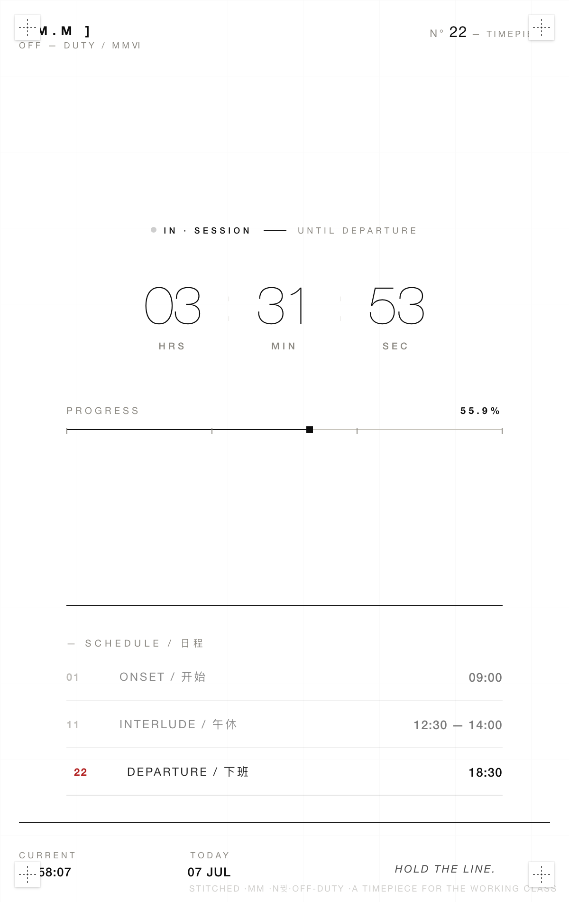

<div align="center">

# ⏰ MIDSUMMER

### 下班倒计时 · 桌面应用

*一个为打工人而造的极简时间装置*

</div>

---

<p align="center">
  
</p>

<p align="center">
  <a href="#-功能特性">✨ 功能特性</a> ·
  <a href="#-设计语言">🎨 设计语言</a> ·
  <a href="#-快速开始">🚀 快速开始</a> ·
  <a href="#-项目结构">📁 项目结构</a> ·
  <a href="#-许可证">📄 许可证</a>
</p>

---

## ✨ 功能特性

基于工作时间（**9:00 上班 / 12:30–14:00 午休 / 18:30 下班**）实时显示倒计时，并智能切换状态：

| 时段 | 状态标识 | 倒计时目标 |
|------|----------|------------|
| 09:00 之前 | `PRE · SHIFT` | 距离开工 |
| 09:00 – 12:30 | `IN · SESSION` | 距离午休 |
| 12:30 – 14:00 | `INTERLUDE` | 距离复工 |
| 14:00 – 18:30 | `IN · SESSION` | 距离下班 |
| 18:30 之后 | `OFF · DUTY` | 自由！ |

**核心能力：**
- ⏱️ **实时倒计时** — 时:分:秒，每秒跳动
- 📊 **工作进度条** — 自动扣除午休时间，显示真实工作完成度
- 🎯 **日程高亮** — 当前所处阶段自动聚焦
- 🎭 **系列切换** — 点击右上角 `N°` 循环切换 5 种主题色系
- 💾 **偏好记忆** — 选择的系列会被保存
- 🖥️ **原生桌面应用** — 双击即开，无边框窗口

---

## 🎨 设计语言

> **Maison Margiela 极简解构主义**

致敬比利时设计师 Maison Margiela 的标志性美学，把一个"打工人倒计时"做成了一件设计单品：

| 元素 | 细节 |
|------|------|
| **配色** | 纯白底 `#FFFFFF` + 炭黑 `#0D0D0D` + 鼠灰 `#8A8780` |
| **字体** | Helvetica Neue · 超细字重（weight 100）· 全大写 · 宽字距 |
| **十字缝线标** | 四角白色十字方块（致敬 MM 招牌四点标） |
| **编号系统** | `N° 22 / TIMEPIECE`（致敬 MM 的 0–23 数字体系） |
| **工业网格** | 背景 2.5% 透明度的极淡网格纹理 |
| **解构文案** | `STEADY HANDS. CLEAR MIND.` `SILENCE IS A MATERIAL.` |

**可切换的 5 个系列（点击右上角编号）：**

| N° | 系列 | 强调色 |
|----|------|--------|
| 04 | ACCESSORIES | `#6B4F2A` 深棕 |
| 06 | MM6 | `#2F4858` 雾蓝 |
| 10 | SHOES | `#5A4A6A` 暗紫 |
| 11 | INTERLUDE | `#3D5A3D` 橄榄 |
| 22 | TIMEPIECE | `#B22222` 暗红 |

---

## 🚀 快速开始

### 方式一：直接用作桌面应用（macOS）

项目根目录已提供打包脚本，执行：

```bash
python3 build_app.py
```

完成后桌面会出现 **「下班倒计时.app」**，双击即可打开。  
首次启动可能需要 1–2 秒初始化（创建独立浏览器 profile），之后秒开。

> 💡 支持自动选择浏览器：Chrome → Edge → Brave → 系统默认浏览器

### 方式二：直接打开网页

双击 `index.html`，或在 VS Code 中右键 → **Open with Live Server**。

### 自定义工作时间

编辑 `script.js` 顶部的常量：

```js
const WORK_START  = 9 * 60;          // 上班时间（分钟）
const LUNCH_START = 12 * 60 + 30;    // 午休开始
const LUNCH_END   = 14 * 60;         // 午休结束
const WORK_END    = 18 * 60 + 30;    // 下班时间
```

---

## 📁 项目结构

```
midsummer/
├── index.html      # 页面结构
├── style.css       # Margiela 极简风格样式
├── script.js       # 倒计时逻辑 + 系列切换
├── build_app.py    # macOS .app 打包脚本（不提交）
├── test_app.py     # Playwright 功能测试（不提交）
├── assets/
│   └── preview.png # README 预览图
└── .gitignore
```

---

## 🛠️ 技术栈

- **前端**：原生 HTML / CSS / JavaScript（零依赖）
- **打包**：Python + Pillow（图标生成）+ Chrome `--app` 模式
- **测试**：Playwright（自动化 DOM 验证）

---

## 📄 许可证

MIT License — 自由使用、修改、分发。

---

<div align="center">

*Made with ☕ for the working class*

**[⬆ 回到顶部](#-midsummer)**

</div>
